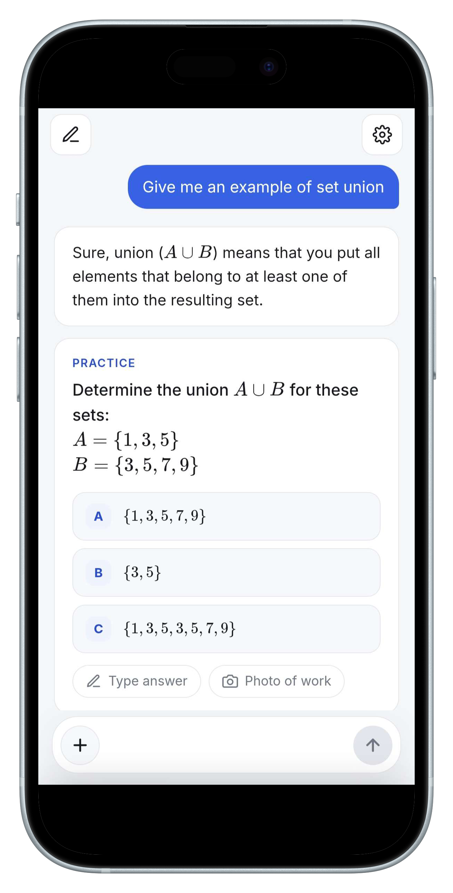

  

  
  

  

**SnapMath** is an AI math tutor in your browser. Snap a photo of a problem or type a question, and get the answer with clear step-by-step cards. Keep asking follow-ups, or ask for a practice problem and get instant feedback on your answer, typed or as a photo of your work.

## Features

- Photo or text in, step-by-step solution out
- Chat that remembers what it said earlier
- Practice mode: multiple choice or open answers, with feedback
- 7 languages (the whole chat is translated when you switch)
- Free Gemini and OpenRouter models to choose from, tagged by photo support
- Light and dark mode, works on phone and PC

## Getting started

1. Open the [site](https://o5-dev.github.io/SnapMath/).
2. Tap the gear icon and paste a free API key: [Gemini](https://aistudio.google.com/apikey) or [OpenRouter](https://openrouter.ai/keys).
3. Snap a problem and ask away.

Your keys stay in your own browser and are sent only to Google or OpenRouter. **Settings → Delete my data** wipes everything.

## Run it yourself

It is a single static page with no build step or server. Fork the repo, then enable **Settings → Pages** (deploy from the root of your branch). To try it locally, run `py -m http.server 8000` and open http://localhost:8000.

> Free-tier models may log your prompts, so don't send anything private.
